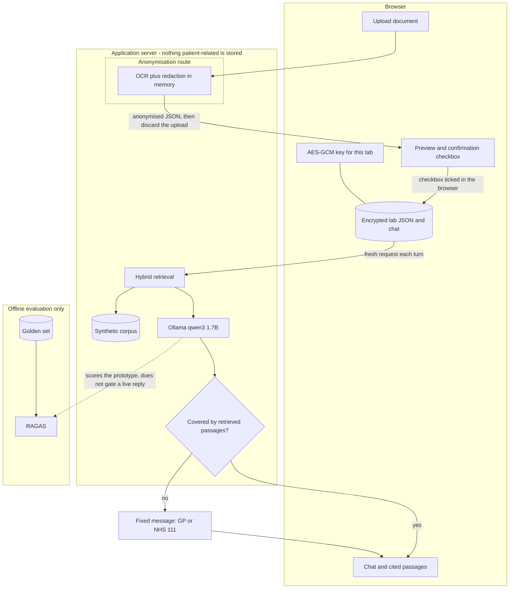
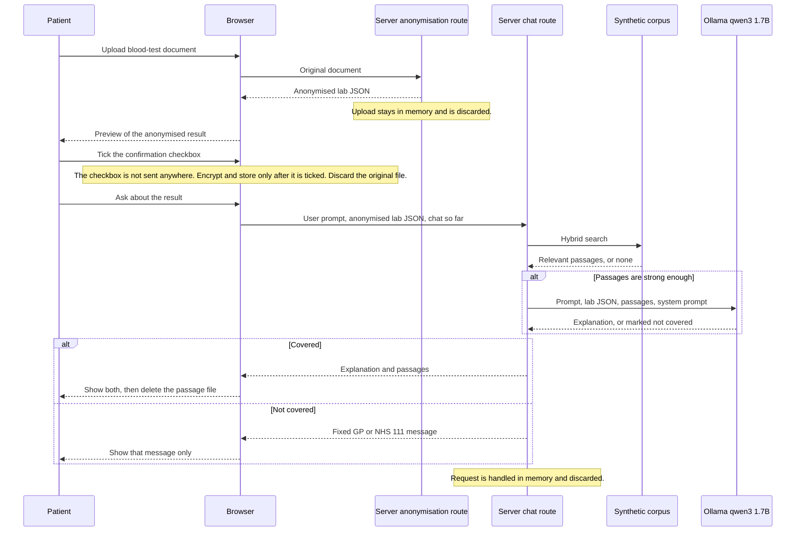
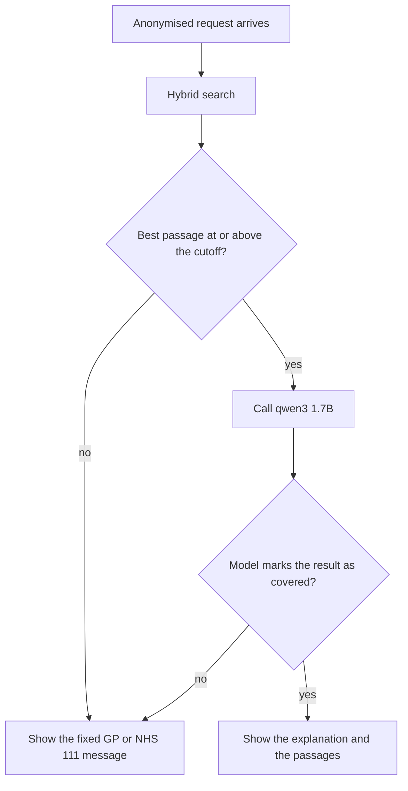
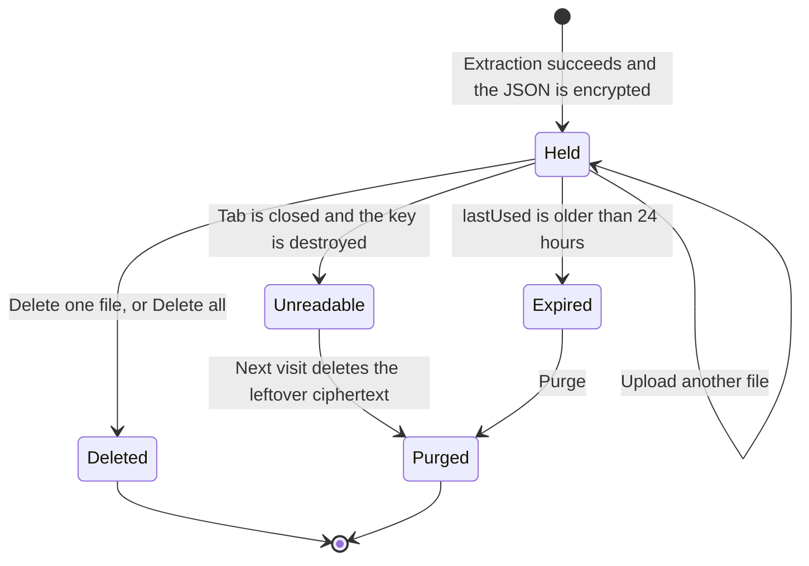
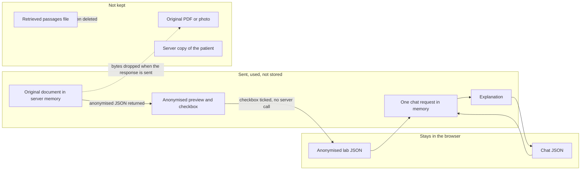

# CarePath AI

CarePath AI is a prototype chatbot. A patient uploads a blood-test report and gets a plain-language explanation of the results.

The explanation is grounded in a local synthetic corpus written for this proof of concept. It is general information, not a diagnosis, and it is not medical advice. The patient sees the model output directly, plus the passages that supported it.

This document freezes the architecture agreed for the prototype. Clinician review and reinforcement learning are future work.

## What the prototype does

1. The patient uploads a blood-test document.
2. The browser sends the document to this server’s anonymisation route. That route reads it in memory, removes identifiers, and returns anonymised JSON. Test name, value, unit, reference range, and the high/low flag are kept. The original file is not stored.
3. The browser shows that anonymised result as a preview. The patient ticks a checkbox to confirm they have looked at it. OCR can misread a value, and Presidio can miss an identifier, so opening the site is not this confirmation. The checkbox stays in the browser. It is not sent to the server, and it creates no server state.
4. After that box is ticked, the browser encrypts the JSON, and later the chat transcript, and keeps both locally. Until then, the explanation does not start.
5. Each chat turn is a new request. The server does not store the patient JSON or the chat.
6. The server retrieves relevant passages from the synthetic corpus and calls a local LLM.
7. The patient sees a short explanation and the passages that supported it. Passage URLs are placeholders for real NHS or NICE links later. The passage file is deleted after it is shown.
8. If the result is not covered, the patient sees one fixed message: contact their GP or NHS 111. The model does not choose between a GP visit and emergency care.

## Architecture



The LLM is [Qwen3 1.7B](https://ollama.com/library/qwen3) served with the local [Ollama](https://ollama.com/) API (`qwen3:1.7b`). Thinking mode is off so the patient reply stays a short explanation. Token log probabilities are not a medical confidence score and are not used to accept or reject an answer.

## Data flow for one turn



The chat is stored as encrypted JSON in the browser. Sending it again on the next turn is what gives the model memory. The server does not keep a session.

## When an answer is shown

RAGAS does not sit on this path. A normal chat model also does not return a calibrated confidence score for “this explanation is medically right.” A number written inside the reply is just more generated text.

The live rule has two steps:

1. **Retrieval cutoff.** Hybrid search returns a similarity score. If the best passage is below the cutoff chosen during evaluation, the model is not asked to explain. The patient gets the fixed GP or NHS 111 message.
2. **Explicit abstention.** If passages exist, the model must return a structured response: whether those passages cover this result, and the explanation. If it marks the result as not covered, the explanation is discarded and the same fixed message is shown.



The cutoff itself is tuned offline. It is not the RAGAS 0.8 figure. That 0.8 faithfulness threshold is only a target for the evaluation report.

### Offline evaluation

RAGAS runs locally on the server, against a golden set. It measures the prototype. It never accepts or rejects a live answer. Faithfulness is the metric that matters for this design: the reply should stay within the retrieved passages. Future work can add clinician validation and use that to train a reinforcement-learning update.

## Browser storage

Patient data stays in the browser. The server receives a request, uses it, and stores nothing about the patient.

| Piece | Where | What it holds |
| --- | --- | --- |
| Ciphertext and IV | IndexedDB | AES-GCM encrypted lab JSON and chat. Survives reload. |
| Key | sessionStorage | The AES-GCM key for this tab. Survives reload. Destroyed when the tab closes. |
| `lastUsed` | IndexedDB, unencrypted, beside the ciphertext | When the file was last used, so expiry can be checked after the key is gone. It does not contain the lab result. |

No password is required. A password would let the files survive closing the tab, which this design does not do. While the tab is open, script on this origin can read the key. Protection starts when the tab closes.

The interface has a per-file **Delete** button and a **Delete all** button. The notice shown to the patient:

> Files stay encrypted in your browser until you delete them, close the tab, or 24 hours pass.



Other storage rules:

- Uploading a new file never deletes an older one. Only the patient deletes files, aside from the 24-hour purge and the purge after a closed tab.
- Closing the tab ends the session. The key is gone immediately, so the ciphertext cannot be read. Leftover bytes are removed the next time the site opens.
- sessionStorage is per tab and IndexedDB is shared. A second tab has no key. On load, purge only when the key is missing and no tab is still alive. A second tab must not delete files that belong to a tab that is still open. It should say that the session is open in another tab.

## Anonymisation

Redaction means removing anything that identifies the person and keeping the lab numbers. It runs on this application server, as its own route, separate from chat and from Ollama. The route returns the anonymised result to the browser and stores nothing.

The browser sends the original document only to that route. The route holds it in memory long enough to read it and mask identifiers, then discards the upload when the response is sent. The chat route never receives the original document. Ollama receives the anonymised JSON only.

Removed before the result is returned:

- patient name, address, phone, email
- NHS number, hospital number, date of birth
- GP or clinician name
- sample barcodes that identify the person

Kept, because the explainer cannot work without them:

- test name, value, unit, reference range, and the high or low flag

The browser drops its copy of the original file when the anonymised JSON comes back. The server does not write the image, the raw OCR text, or the JSON to disk or to logs.

This step is owned by a teammate (OCR, Microsoft Presidio, or another tool they choose). The in-memory implementation for synthetic images is `server/anonymisation/`: `ocr.py` reads the image, `redact_text.py` masks identifiers in the text, `redact_image.py` covers those words on the image, and `privacy.py` returns the result. `server/api/anonymise_route.py` is the HTTP entry for that result. Retrieval and the LLM do not import the upload. Sample images and the privacy tests live in `tests/`.

If that step later calls a company OCR or redaction API, check its terms for retention, training, and logging before a real report is sent.

### Confirming the preview

OCR can misread a laboratory value, and Presidio can miss an identifier. Agreeing to use the platform is not the same as checking that this result was read and anonymised properly.

Before any explanation, the browser shows the anonymised results and a confirmation checkbox. The patient ticks it only after looking at the preview. The chat route is not called until that box is ticked, and the lab JSON is encrypted only then. An unticked preview is not stored.

The checkbox is entirely on the frontend. There is no approval request, no extra API call, and no server state for the decision. This keeps the check that the anonymisation worked, without a second server step.

## Retrieval corpus

The corpus is a JSON file written for this prototype. It is not scraped from NHS, NICE, or any other site. Passages are simulated explanations in language a patient can understand. Each `simulatedUrl` is a placeholder on `example.nhs.uk`, not a real guideline link.

Panels in scope:

- full blood count
- U&E (kidney tests)
- liver tests
- HbA1c
- lipids
- thyroid
- iron studies

Each record is one analyte in one band. The band is decided from the reference range printed on that patient’s report, not from a range hardcoded in the corpus.

```json
{
  "id": "fbc-haemoglobin-high",
  "panel": "full_blood_count",
  "analyte": "haemoglobin",
  "aliases": ["Hb", "haemoglobin", "hemoglobin"],
  "band": "high",
  "title": "Haemoglobin above the range on your report",
  "text": "Plain-language explanation for the prototype.",
  "simulatedUrl": "https://example.nhs.uk/explain/haemoglobin"
}
```

`band` is `low`, `normal`, or `high`. Keyword search uses `aliases`. Embeddings use `title` and `text`. The current retriever is a hybrid of both. Real guideline templates and preprocessing are future work.

The patient can see the passages that were used. They are returned as a separate JSON file and deleted afterwards, so the reply stays interpretable without leaving that file behind.

## What is stored where



## Folder structure

The repository is split along the same boundaries as the architecture. The browser, the two server routes, the corpus, and offline evaluation do not share code. Anonymisation is on this server and stays in its own package. JSON shapes that cross those boundaries live in `shared/contracts/`. Chat, retrieval, and browser files are still empty. In-memory redaction for synthetic images lives in `server/anonymisation/`. The handmade retrieval passages live in `corpus/passages.json`.

```
client/                  browser only
  index.html
  src/main.js
  src/styles/app.css
  src/upload/            choose the document, then drop the original
  src/redaction-client/  post the document, show the preview, accept it only after the checkbox
  src/storage/           AES-GCM, IndexedDB, session key, lastUsed, purge, tab lock, delete
  src/chat/              encrypted transcript and sending a turn
  src/passages/          show cited passages, then delete that file
  src/api/               one fresh request per turn
  src/notice/            the storage notice
  src/refusal/           fixed GP or NHS 111 message

server/                  stateless application server
  app.py
  api/                   two HTTP entries, kept apart
    anonymise_route.py   document in, anonymised JSON out, nothing stored
    chat_route.py        anonymised JSON in, explanation out, nothing stored
  anonymisation/         teammate’s OCR and redaction, in memory
    ocr.py               read the image and return words plus boxes
    redact_text.py       mask identifiers in the OCR text
    redact_image.py      cover those words on a copy of the image
    privacy.py           compose the three steps and return the result
    to_lab_json.py       still empty
    discard_original.py  still empty
  retrieval/             corpus load, keyword, embedding, hybrid, cutoff
  llm/                   prompt assembly and Ollama
  gate/                  covered or not, and the fixed message
  passages/              citation JSON returned to the browser
  privacy/               both requests handled in memory, then discarded
  config/

corpus/passages.json     33 analytes, low / normal / high, seven panels

evaluation/              offline RAGAS only
  run_ragas.py
  faithfulness.py
  tune_cutoff.py
  golden/golden_set.json

shared/contracts/        JSON shapes shared by the browser and the server
  lab_result.schema.json
  passage.schema.json          shape of one corpus passage
  chat_turn_request.schema.json
  chat_turn_response.schema.json
  coverage.schema.json

tests/                   anonymisation checks only, for now
  test_privacy.py
  fixtures/synthetic/    sample blood-test image and a redacted copy
```

`client/` is plain browser JavaScript. It owns upload, the anonymised preview and confirmation checkbox, encryption, the chat transcript, and the notice. It never keeps the original document or the passage file. The checkbox never leaves the browser.

`server/` is Python. `api/anonymise_route.py` accepts the original document and returns anonymised JSON. `api/chat_route.py` accepts only that JSON. Neither route writes a patient record. `anonymisation/` is the teammate’s package, and it is the only server code that sees the upload. `ocr.py`, `redact_text.py`, and `redact_image.py` each do one part of that work. `privacy.py` composes them. `retrieval/` searches the corpus. `llm/` builds the prompt and calls Ollama with thinking mode off. `gate/` applies the retrieval cutoff and the coverage check. `passages/` builds the citation JSON the browser shows and then deletes. `privacy/` is the boundary that discards both requests after the response is sent. There is no database package.

`tests/` holds the anonymisation checks and the synthetic images those checks use.

`corpus/` holds the handmade passage file the retriever reads.

`evaluation/` runs RAGAS against the golden set and is where the retrieval cutoff is tuned. The live server does not import it.

`shared/contracts/` is the only place the lab result, a corpus passage, a chat request, a chat response, and the coverage flag are defined. The other packages follow those shapes.

## Out of scope for now

- Clinician validation of answers.
- Reinforcement learning from that validation.
- Live RAGAS, or any other online confidence score, as the accept or refuse switch.
- Real NHS or NICE pages, scraped text, or live links.
- Choosing between “see your GP” and “go to emergency.” The prototype uses one fixed, non-diagnostic message.
- A user password for encryption.

## Prototype status

Chat, retrieval, browser storage, and the anonymisation HTTP route are still empty. `corpus/passages.json` holds the handmade passages. `server/anonymisation/` redacts a synthetic image in memory and returns the result without saving it. Anonymisation remains a teammate’s workstream on this server, under the rule that the upload is returned to the browser and not stored.
